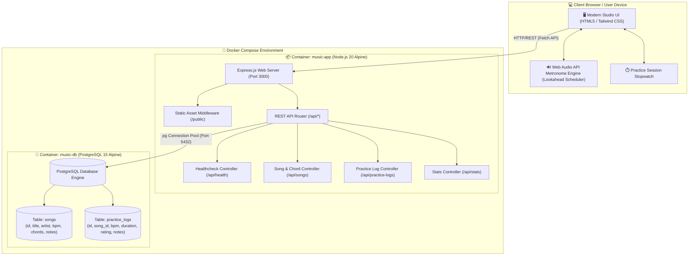

# 🎵 Music Practice & Metronome Web Application

> เว็บแอปพลิเคชันสำหรับนักดนตรีและผู้ฝึกซ้อมเครื่องดนตรี รวมระบบเคาะจังหวะ Metronome เที่ยงตรงสูง, คลังคอร์ดและเพลงที่ต้องฝึก, พร้อมระบบบันทึกประวัติและสถิติการซ้อม (Practice Logs) เชื่อมต่อฐานข้อมูล PostgreSQL ผ่าน Docker Compose อย่างสมบูรณ์แบบ

---

## 📌 ที่มาและความสำคัญของแอปพลิเคชัน (Problem Statement & Concept)

### ปัญหาที่พบในการฝึกซ้อมดนตรี (Pain Points)
1. **การลืมความเร็ว BPM ของแต่ละเพลง:** นักดนตรีมักจำไม่ได้ว่าเพลงแต่ละเพลง หรือท่อนโซโล่แต่ละท่อน ซ้อมค้างไว้ที่ความเร็วเท่าไร ทำให้เริ่มฝึกใหม่ด้วยสปีดที่ไม่เหมาะสม
2. **คอร์ดและโน้ตกระจัดกระจาย:** โน้ตเพลง คอร์ด หรือเทคนิคจำเพาะ มักจดไว้บนกระดาษ หรือแชทส่วนตัว ทำให้ค้นหาไม่สะดวกขณะจับกีตาร์หรือเครื่องดนตรี
3. **ขาดระบบบันทึกและติดตามผล (Lack of Practice Tracking):** การซ้อมที่ไม่มีการจดบันทึกเวลา ความแม่นยำ และสิ่งที่ต้องแก้ไขในแต่ละวัน ทำให้พัฒนาการช้า และไม่เห็นความก้าวหน้าอย่างเป็นรูปธรรม
4. **ความไม่เที่ยงตรงของ Metronome บนเว็บทั่วไป:** เว็บ Metronome ทั่วไปที่ใช้คำสั่ง `setInterval` ของ JavaScript มักเกิดปัญหา Audio Drift (เสียงหน่วงหรือไม่ตรงจังหวะ) เมื่อเบราว์เซอร์ทำงานหนัก

### แนวคิดในการแก้ไขปัญหา (Solution & Concept)
**Music Practice & Metronome Web App** พัฒนาขึ้นมาเพื่อเป็น "ห้องซ้อมดนตรีดิจิทัลส่วนตัว" โดยผสาน:
- **Audio Engine ที่แม่นยำสูง:** ใช้ Web Audio API (`AudioContext`) พร้อม Lookahead Scheduling ป้องกันจังหวะแกว่ง
- **Song & Chord Management:** จัดเก็บเพลง BPM เป้าหมาย และทางเดินคอร์ด เพื่อคลิกโหลดเข้าสู่ Metronome ได้ทันที
- **Practice Stopwatch & Intelligent Logging:** จับเวลาการซ้อมจริง ให้คะแนนความแม่นยำ และบันทึกโน้ตสรุปผลเข้า PostgreSQL อัตโนมัติ

---

## 🏛️ System Architecture

สถาปัตยกรรมระบบได้รับการออกแบบตามหลัก Containerized Micro-architecture โดยแยกส่วนเว็บแอปพลิเคชัน (Node.js/Express) และฐานข้อมูล (PostgreSQL) ออกจากกันอย่างเป็นอิสระ เชื่อมต่อผ่าน Docker Bridge Network:



---

## 📋 ข้อกำหนดของระบบ (Prerequisites)

- **Docker Desktop** (เวอร์ชัน 20.10+ ขึ้นไป) หรือ **Docker Engine** พร้อม **Docker Compose v2**
- **Web Browser** ที่รองรับ Web Audio API (เช่น Google Chrome, Microsoft Edge, Firefox, Safari)
- *(ทางเลือกเพิ่มเติมสำหรับการรันแบบ Local Dev)*: Node.js v18+ และ PostgreSQL 14+

---

## 🚀 ขั้นตอนการติดตั้งและเริ่มใช้งาน

### 1. โคลนคลังโค้ด (Clone Repository)
```bash
git clone https://github.com/your-username/music-practice-metronome.git
cd music-practice-metronome
```

### 2. สั่งรันด้วย Docker Compose
ใช้คำสั่งเดียวเพื่อสั่ง Build Image แบบ Multi-stage และเริ่มต้นรัน Containers:
```bash
docker compose up --build -d
```

### 3. ตรวจสอบสถานะ Containers
```bash
docker compose ps
```
คุณจะพบว่ามี 2 Containers รันอยู่:
- `music-db` (PostgreSQL 15) พร้อมสถานะ `healthy`
- `music-app` (Node.js 20 Express) เชื่อมต่อไปยังพอร์ต `3000`

### 4. เปิดเข้าใช้งานแอปพลิเคชัน
เปิดเบราว์เซอร์ไปที่:
👉 **[http://localhost:3000](http://localhost:3000)**

---

## 🌐 การแชร์แอปพลิเคชันให้ผู้อื่นเข้าใช้งาน (Public Sharing & Deployment)

### วิธีที่ 1: แชร์ให้คนอื่นทดสอบแบบฉับไวผ่าน Local Tunnel (ฟรี ไม่ต้องเซ็ตเราเตอร์)
หากต้องการส่งลิงก์ให้เพื่อนในวงดนตรีหรือครูสอนดนตรีทดสอบใช้งานทันที สามารถใช้เครื่องมือเช่น **Cloudflare Tunnel** หรือ **ngrok**:

```bash
# กรณีใช้ Cloudflare Tunnel (ไม่ต้องสมัครสมาชิก)
npx untun tunnel http://localhost:3000

# หรือกรณีใช้ ngrok
ngrok http 3000
```
ระบบจะให้ Public URL แบบ HTTPS (เช่น `https://random-subdomain.trycloudflare.com`) เพื่อส่งให้ผู้อื่นเปิดใช้งานจากสมาร์ทโฟนหรือคอมพิวเตอร์เครื่องอื่นได้ทันที

### วิธีที่ 2: แชร์ผ่าน Local Network (LAN / Wi-Fi เดียวกัน)
1. ค้นหาหมายเลข IP เครื่องของคุณ เช่น `ipconfig` (Windows) -> ดู `IPv4 Address` (เช่น `192.168.1.50`)
2. อุปกรณ์อื่นที่เชื่อมต่อ Wi-Fi เดียวกันสามารถเข้าผ่าน `http://192.168.1.50:3000`

### วิธีที่ 3: Deploy ขึ้น Cloud ฟรี (Render / Railway)
- นำโค้ดขึ้น GitHub Repository
- เชื่อมต่อ Repository เข้ากับ Render หรือ Railway
- เลือก Deploy เป็น Web Service (Docker) ระบบจะดึง Dockerfile และสร้าง URL สาธารณะให้อัตโนมัติ

---

## 📚 API Reference

ระบบมาพร้อมกับ RESTful API ครบวงจรสำหรับจัดการเพลงและประวัติการซ้อม:

### 1. System Health
| Method | Endpoint | คำอธิบาย |
| :--- | :--- | :--- |
| `GET` | `/api/health` | ตรวจสอบสถานะ Container, Uptime และการเชื่อมต่อฐานข้อมูล PostgreSQL |

### 2. Songs & Chords Management
| Method | Endpoint | Body (JSON) | คำอธิบาย |
| :--- | :--- | :--- | :--- |
| `GET` | `/api/songs` | - | ดึงรายชื่อเพลงและคอร์ดทั้งหมด |
| `GET` | `/api/songs/:id` | - | ดึงข้อมูลเพลงรายตัว |
| `POST` | `/api/songs` | `{"title", "artist", "target_bpm", "chords", "notes"}` | เพิ่มเพลงใหม่ลงคลัง |
| `PUT` | `/api/songs/:id`| `{"title", "artist", "target_bpm", "chords", "notes"}` | แก้ไขข้อมูลเพลง |
| `DELETE` | `/api/songs/:id`| - | ลบเพลงออกจากคลัง |

### 3. Practice Logs & Stats
| Method | Endpoint | Body (JSON) | คำอธิบาย |
| :--- | :--- | :--- | :--- |
| `GET` | `/api/practice-logs` | - | ดึงประวัติการซ้อมทั้งหมด เรียงจากล่าสุด |
| `POST` | `/api/practice-logs` | `{"song_title", "bpm_practiced", "duration_minutes", "accuracy_rating", "notes"}` | บันทึกประวัติการซ้อมรอบใหม่ |
| `DELETE` | `/api/practice-logs/:id` | - | ลบรายการบันทึกการซ้อม |
| `GET` | `/api/stats` | - | ดึงสถิติภาพรวม (จำนวนเพลง, เวลารวม, BPM เฉลี่ย) |

---

## 🛠️ โครงสร้างโปรเจกต์ (Project Structure)

```text
├── Dockerfile              # Multi-stage production build สำหรับ Node.js
├── docker-compose.yml      # Orchestration กำหนด Container, Volume และ Healthcheck
├── package.json            # นิยาม Dependencies และ Scripts
├── server.js               # Express API Backend & Auto-migration PostgreSQL
├── public/                 # ส่วนติดต่อผู้ใช้ (Frontend)
│   └── index.html          # Single Page App: Web Audio Metronome & Practice Log
├── README.md               # เอกสารคู่มือการติดตั้งและการใช้งานฉบับสมบูรณ์
└── snapshots/              # ข้อมูลผลการทดสอบ API (Test Result Snapshots)
```

---

## 🛡️ License
โปรเจกต์นี้เผยแพร่ภายใต้สัญญาอนุญาต [MIT License](LICENSE)
