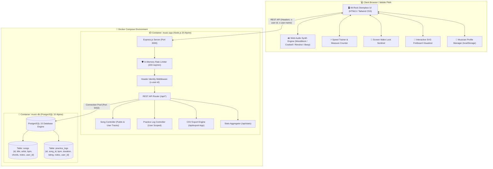

# ⚡ RiffRig: Alt-Rock Metronome & Practice Workstation

> เว็บแอปพลิเคชันสำหรับนักดนตรี มือกีตาร์ และมือเบสสายร็อก รวมระบบเคาะจังหวะ Metronome แบบ Stompbox เที่ยงตรงสูงด้วย Web Audio API, โหมดเร่งสปีดอัตโนมัติ (Speed Trainer), ผังคอร์ดกีตาร์แบบโต้ตอบ (Interactive Chord Charts), ระบบแยกโปรไฟล์ผู้ใช้ (Musician Profiles), และระบบบันทึกประวัติพร้อมส่งออก CSV ผ่าน Docker Compose และ PostgreSQL

---

## 📌 ที่มาและความสำคัญของแอปพลิเคชัน (Problem Statement & Concept)

### ปัญหาที่พบในการฝึกซ้อมดนตรี (Pain Points)
1. **การลืมความเร็ว BPM ของแต่ละเพลง:** นักดนตรีมักจำไม่ได้ว่าเพลงแต่ละเพลง หรือท่อนโซโล่แต่ละท่อน ซ้อมค้างไว้ที่ความเร็วเท่าไร ทำให้เริ่มฝึกใหม่ด้วยสปีดที่ไม่เหมาะสม
2. **คอร์ดและโน้ตกระจัดกระจาย:** ข้อมูลคอร์ดและสัดส่วนจังหวะมักจดไว้บนกระดาษหรือแชทส่วนตัว ไม่มีผังคอร์ด (Fretboard) ให้ดูอย่างสะดวก
3. **ขาดระบบดันสปีดการซ้อม:** การฝึกสปีดแบบดั้งเดิมต้องเอื้อมมือไปเลื่อนจังหวะเอง ทำให้จังหวะสะดุดและเสียสมาธิ
4. **ความไม่เที่ยงตรงของ Metronome บนเว็บทั่วไป:** เว็บ Metronome ทั่วไปที่ใช้ `setInterval` ของ JavaScript มักเกิดปัญหา Audio Drift (เสียงหน่วงหรือไม่ตรงจังหวะเมื่อเบราว์เซอร์ทำงานหนัก)
5. **ปัญหาหน้าจอมือถือดับระหว่างซ้อม:** เมื่อวางมือถือบนขาตั้งโน้ต หน้าจอมักจะล็อกเองหลังจากไม่ได้แตะหน้าจอ 1 นาที

### แนวคิดในการแก้ไขปัญหา (Solution & Concept)
**RiffRig** ถูกออกแบบมาเพื่อเป็น "แป้นเหยียบเอฟเฟกต์ดิจิทัลในสตูดิโอ" โดยผสาน:
- **Audio Engine ที่แม่นยำสูง & 4 Sound Kits:** ใช้ Web Audio API (`AudioContext`) พร้อม Lookahead Scheduling และมีเสียง Woodblock, Rock Cowbell, Rimshot, และ Cyber Beep
- **Speed Trainer (Auto Accelerate):** ระบบเร่งความเร็วอัตโนมัติ เพิ่ม BPM ทุกๆ N ห้อง จนถึงเป้าหมายโดยไม่ต้องปล่อยมือจากคอกีตาร์
- **Screen Wake Lock API:** ป้องกันหน้าจอมือถือ/แท็บเล็ตดับขณะกำลังซ้อมดนตรี
- **Interactive Chord Diagrams:** คลิกดูผังคอร์ดกีตาร์ 6 สาย (Fretboard SVG) พร้อมบอกตำแหน่งนิ้วและสายที่ต้อง Mute
- **Musician Profile & Data Isolation:** รองรับการใช้งานพร้อมกันหลายคน โดยแยกเพลงและประวัติการซ้อมของแต่ละโปรไฟล์ออกจากกันอย่างปลอดภัย
- **CSV Report Export:** ส่งออกประวัติการซ้อมเป็นไฟล์ CSV นำไปเปิดใน Excel หรือส่งให้ครูผู้สอนได้ทันที
- **Hands-Free Keyboard Hotkeys:** คีย์ลัด Spacebar (Play/Stop), T (Tap Tempo), ลูกศรขึ้นลง (BPM +/-)

---

## 🏛️ System Architecture



---

## ⌨️ คีย์ลัดสำหรับฝึกซ้อม (Hands-Free Hotkeys)

| คีย์ลัด | คำสั่ง | คำอธิบาย |
| :---: | :--- | :--- |
| <kbd>SPACE</kbd> | **Play / Stop** | เริ่มหรือหยุดการเคาะจังหวะ Metronome |
| <kbd>T</kbd> | **Tap Tempo** | เคาะจับหาความเร็ว BPM ตามจังหวะที่กด |
| <kbd>↑</kbd> หรือ <kbd>→</kbd> | **BPM +1** | เพิ่มความเร็วขึ้น 1 BPM (กดคู่กับ Shift เพื่อ +5) |
| <kbd>↓</kbd> หรือ <kbd>←</kbd> | **BPM -1** | ลดความเร็วลง 1 BPM (กดคู่กับ Shift เพื่อ -5) |
| <kbd>S</kbd> | **Speed Trainer** | เปิด/ปิด โหมดเร่งความเร็วอัตโนมัติ |
| <kbd>ESC</kbd> | **Close Modal** | ปิดหน้าต่างผังคอร์ด หรือโปรไฟล์ |

---

## 📋 ข้อกำหนดของระบบ (Prerequisites)

- **Docker Desktop** หรือ **Docker Engine** พร้อม Docker Compose
- **Web Browser** รุ่นใหม่ที่รองรับ Web Audio API (Chrome, Safari, Edge, Firefox)

---

## 🚀 ขั้นตอนการติดตั้งและเริ่มใช้งาน

### 1. โคลนคลังโค้ด (Clone Repository)
```bash
git clone https://github.com/F22lightning/Project-com.git
cd Project-com
```

### 2. สั่งรันด้วย Docker Compose
```bash
docker compose up --build -d
```

### 3. เปิดใช้งานแอปพลิเคชัน
เปิดเบราว์เซอร์ไปที่:
👉 **[http://localhost:3000](http://localhost:3000)**

---

## 📚 API Reference

ระบบมาพร้อมกับ RESTful API พร้อมตัวกรองตาม `x-user-id`:

### 1. System Health
| Method | Endpoint | คำอธิบาย |
| :--- | :--- | :--- |
| `GET` | `/api/health` | ตรวจสอบสถานะ Container, Uptime และ PostgreSQL Connection |

### 2. Songs & Chords Management
| Method | Endpoint | Body (JSON) | คำอธิบาย |
| :--- | :--- | :--- | :--- |
| `GET` | `/api/songs` | - | ดึงรายชื่อเพลงเฉพาะของโปรไฟล์ และเพลง Global Demo |
| `POST` | `/api/songs` | `{"title", "artist", "target_bpm", "chords", "notes"}` | เพิ่มเพลงใหม่ผูกกับโปรไฟล์ตนเอง |
| `DELETE` | `/api/songs/:id`| - | ลบเพลง (ลบได้เฉพาะเพลงที่ตนเองสร้าง) |

### 3. Practice Logs & Stats
| Method | Endpoint | Body (JSON) | คำอธิบาย |
| :--- | :--- | :--- | :--- |
| `GET` | `/api/practice-logs` | - | ดึงประวัติการซ้อมของโปรไฟล์ตนเอง |
| `POST` | `/api/practice-logs` | `{"song_title", "bpm_practiced", "duration_minutes", "accuracy_rating", "notes"}` | บันทึกรอบการซ้อม |
| `DELETE` | `/api/practice-logs/:id`| - | ลบประวัติการซ้อมของตนเอง |
| `GET` | `/api/stats` | - | สถิติเวลารวม, รอบที่ซ้อม, และ BPM เฉลี่ยของตนเอง |
| `GET` | `/api/export-logs` | - | ดาวน์โหลดไฟล์ประวัติการซ้อมเป็น **CSV (UTF-8)** |

---

## 🛠️ โครงสร้างโปรเจกต์ (Project Structure)

```text
├── Dockerfile              # Multi-stage production build สำหรับ Node.js
├── docker-compose.yml      # กำหนด 2 Services: music-app และ music-db (PostgreSQL 15)
├── package.json            # นิยาม Dependencies และ Scripts
├── server.js               # Express API, In-memory Rate Limiter & PostgreSQL Multi-user Schema
├── public/                 # ส่วนติดต่อผู้ใช้ (Frontend)
│   ├── index.html          # Single Page App: RiffRig Alt-Rock Workstation
│   ├── manifest.json       # PWA Application Manifest
│   └── sw.js               # Service Worker สำหรับ Offline Asset Caching
├── README.md               # เอกสารคู่มือและการใช้งาน
└── snapshots/              # ข้อมูลผลการทดสอบ API (Test Result Snapshots)
```

---

## 🛡️ License
โปรเจกต์นี้เผยแพร่ภายใต้สัญญาอนุญาต [MIT License](LICENSE)
